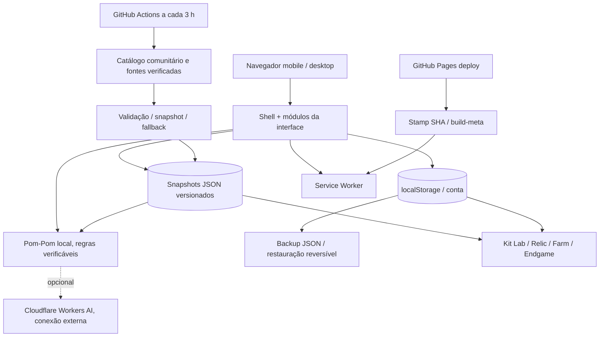

# Arquitetura técnica — Anderus Star Rail Nexus 2.0

**Escopo:** branch de revisão `fix/nexus-2-0-data-integrity-cache`, PR #1. **Produção inalterada até o merge.**

## Resumo

Aplicativo estático orientado a arquivos, publicado no GitHub Pages. O núcleo da interface ainda convive com camadas legadas em `index.html`, `v06.js`, `nexus-v07.js` e `nexus-v09.js`. Os novos recursos 2.0 são módulos JavaScript/CSS independentes. A arquitetura não deve ser descrita como reescrita integral até a migração do HTML monolítico.

## Módulos e responsabilidade

| Área | Arquivo | Responsabilidade |
| --- | --- | --- |
| Núcleo legado | `index.html`, `v06.js`, `v06.css` | Roteamento, telas originais e contrato histórico de dados |
| Evolução da interface | `nexus-v07.js`, `nexus-v09.js` | Bootstrap de módulos, conteúdo editorial, Endgame |
| Núcleo de dados de equipamentos | `nexus-account-engine.js` | Normalização, reconciliação de seis relíquias, análise determinística |
| Scan | `relic-auto.js`, `relic-inspector.js`, `nexus-scan-layout.js`, `nexus-scan-input.js` | Entrada, classificação limitada, OCR e formulário manual |
| Kit | `nexus-kit-lab.js` | Habilidades, níveis, rastros, Eidolons, arte e resumo |
| Assistente | `nexus-pompom-chat.js` | Respostas locais contextualizadas, fonte, orientação para módulos |
| Equipamentos | `nexus-relic-optimizer.js` | Sinais de atributos derivados do kit e integridade dos dados |
| Equipes | `nexus-team-lab.js` | Quatro personagens possuídos, papéis, conflitos, equipes salvas |
| Farm | `nexus-farm-lab.js`, `nexus-trace-planner.js`, `nexus-material-budget.js` | Metas, rastros, estoque compartilhado, faltantes agregados |
| Saltos | `nexus-warp-math.js`, `nexus-warp-advisor.js` | Hard pity, garantias e modelo de chance conservador |
| Busca | `nexus-search.js` | Pesquisa PT-BR e nomes internacionais pelo mesmo ID |
| PWA | `sw.js`, `scripts/stamp-release.mjs`, `nexus-diagnostics.js` | Cache por SHA, rede prioritária, versão, diagnóstico e atualização |
| Backup | `nexus-backup.js` | Exportação, mesclagem, substituição e desfazer última importação |
| Temas | `themes/aha*.css`, `nexus-theme-bridge.js`, `nexus-theme-overlays.css` | Identidade Aha/Original e propagação a diálogos |
| Alertas | `nexus-notifications.js` | Boletins locais com fonte e distinção oficial/beta |

## Fonte de dados, validade e transparência

- `data/live-game.json`: personagens, cones, habilidades, Eidolons e conjuntos, derivados de fonte comunitária estruturada em PT-BR.
- `data/character-traces.json`: rastros e materiais, separados da build da conta.
- `data/ascension-materials.json`: custos de ascensão e dados de itens.
- `data/search-aliases.json`: nomes ingleses indexados pelo ID canônico; não cria personagens duplicados.
- `data/eidolon-art.json`: imagens por personagem e Eidolon; falhas de imagens devem ter estado alternativo.
- `data/beta-watch.json`: revisões **não confirmadas como kit final**.
- `data/endgame-verified.json`: modificadores de versão com fonte, datas de validade e grau de verificação.

**Regra:** não inferir valores de atributos ausentes e não promover rumor a dado oficial. Atualizações upstream passam por verificações de contagem e coerência antes de substituir snapshots; arte e dados podem ter disponibilidade independente.

## Persistência e evolução da conta

- Chave histórica preservada: `anderus_nexus_v03`.
- O cadastro não exige seis atributos gerais completos se a leitura da imagem falhou.
- A normalização de equipamento não converte um número observado para uma referência suposta de nível +15.
- `mergeRelicImport` preserva peças já registradas quando um OCR não encontra valores, sem copiar subatributos entre conjuntos incompatíveis.
- Histórico reversível das builds, até 20 versões anteriores por personagem, armazenado localmente.
- Recursos de materiais e planos são exportados em JSON. Estoques de diferentes dispositivos não são somados automaticamente.
- Uma restauração guarda previamente a versão original em uma chave de segurança, com ação de desfazer.

**Limite de arquitetura:** `localStorage` NÃO equivale a sincronização em nuvem. Celular e desktop não compartilham dados automaticamente. Sincronização real exigiria backend, autenticação e política de conflito.

## Publicação e cache

`pages.yml` executa `scripts/stamp-release.mjs` durante o deploy. O Service Worker recebe uma chave derivada do SHA do commit, e o arquivo `build-meta.json` registra a versão servida. Recursos priorizam rede e usam cache como fallback; dados JSON não recebem HTML substituto quando indisponíveis.

A build no GitHub Pages só é modificada por publicação da `main`. Commits em PR não são um deploy.

## Testes e observabilidade

- `.github/workflows/quality.yml`: sintaxe, cobertura de catálogos, Eidolons, índices, bônus e dados históricos, importação parcial, preservação de valores, materiais e backups.
- `.github/workflows/browser-ux.yml`: Chromium real em 390 e 1440 px, capturas de módulos, persistência, atualização PWA e fluxo de personagem.
- `scripts/browser-smoke.mjs`: capturas de Home também em 320, 360, 430, 768, 1024 e 1920 px.
- `scripts/build-review-gallery.mjs`: galeria de revisão visual acessível no ZIP de artefatos do CI.
- `nexus-diagnostics.js`: identificação de build, cache, Service Worker, catálogo e armazenamento sem enviar dados pessoais.

Uma verificação bem-sucedida de Chromium não comprova funcionamento no Android físico, em screenshots reais variados ou em um navegador webview específico.

## Riscos e dívida técnica

1. O `index.html` continua muito grande e contém comportamento legado sobreposto a módulos posteriores. Precisa de refatoração incremental e testes, não substituição brusca.
2. OCR multiformato ainda NÃO foi calibrado em um conjunto suficientemente amplo de prints reais. Dois layouts principais têm reconhecimento estruturado; demais layouts mantêm edição manual.
3. O modo local do Pom-Pom é uma camada de regras e recuperação de dados, não um modelo conversacional generativo completo. Cloudflare AI depende de implantação e conexão externa.
4. Recomendação de equipe, DPS/ciclos e taxas de drop não podem ser apresentados como resultado garantido sem datasets e modelos verificáveis.
5. O redesign e a fidelidade temática exigem QA visual manual com conteúdo real, especialmente em telas longas e em dispositivos físicos.

## Próximo portão de publicação

Não fazer merge por conveniência. Exigir CI estático e browser verdes no commit final, amostras reais de importação verificadas, revisão visual Aha/Original, backup/restauração com conta existente, e aceite explícito da revisão final.
